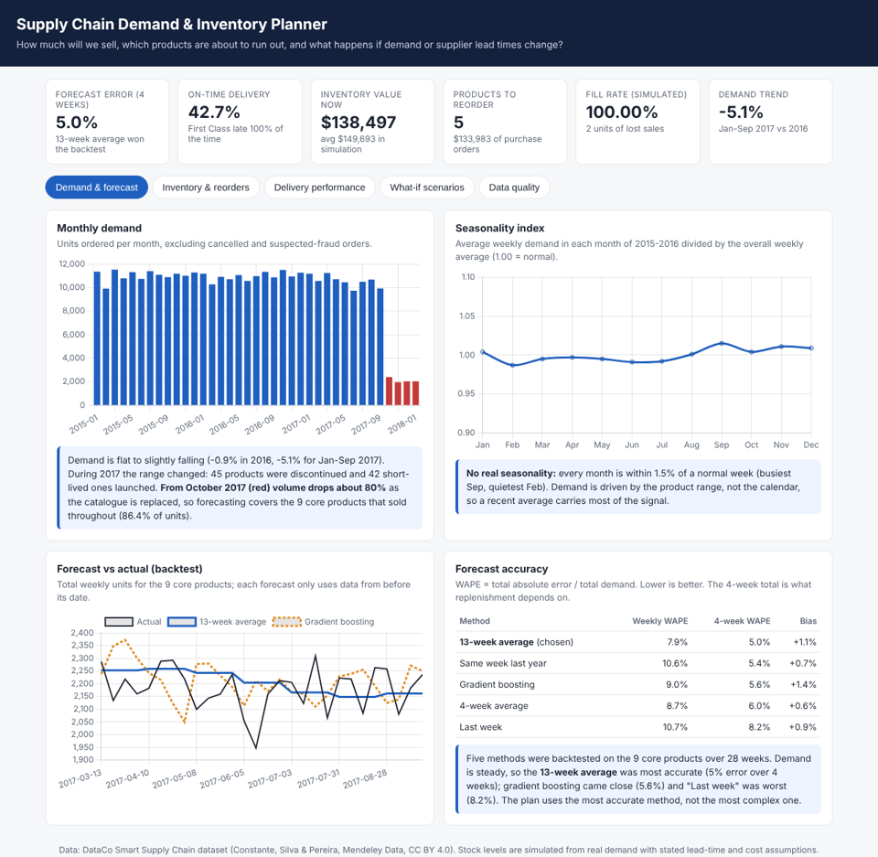
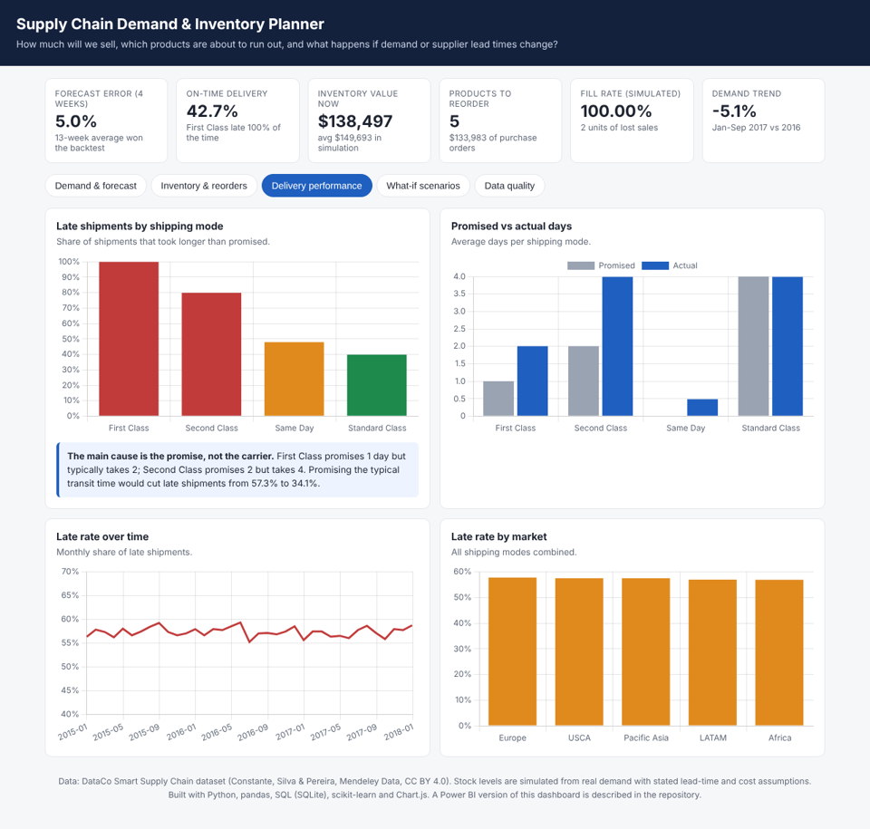
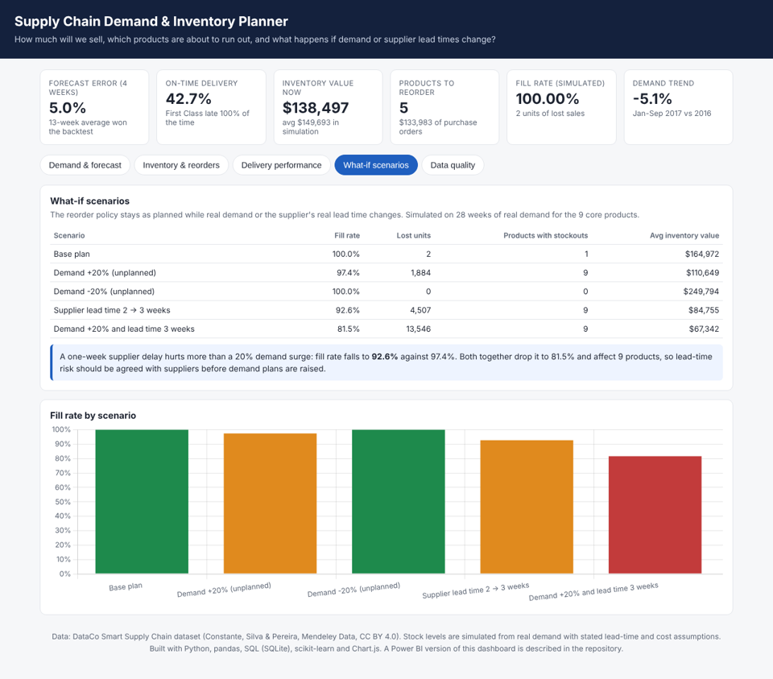

# Supply Chain Demand Forecasting & Inventory Planning


**Business problem:** how can a company forecast product demand, cut stockout risk and plan inventory, and how exposed is it if demand or supplier lead times change?

**Live dashboard:** https://s-harshni.github.io/Supply-Chain-Demand-Forecasting-Inventory-Planning/



## Key findings

| Question | Answer |
| --- | --- |
| Is demand growing? | No. Units fell 0.9% in 2016 and 5.1% in Jan–Sep 2017, and there is **no real seasonality** (every month within 1.5% of a normal week). |
| What changed in the range? | 45 products were discontinued and 42 short-lived ones launched during 2017; from October 2017 the catalogue is replaced and volume drops about 80%. Only **9 core products** sold throughout, and they carry **86.4% of units**. |
| How accurate is the forecast? | Five methods were backtested on 28 weeks. The **13-week average** was most accurate (**5.0% error** over 4 weeks); gradient boosting came close at 5.6%. The plan uses the most accurate method, not the most complex one. |
| What should be reordered now? | **5 of 9 core products** are at or below their reorder point; recommended purchase orders total **$133,983**. Inventory on hand is worth $138,497. |
| Where are deliveries failing? | Only **42.7% of shipments arrive on time**. First Class is late 100% of the time (promises 1 day, takes 2) and Second Class 79.8% (promises 2, takes 4). Promising the typical transit time would cut late shipments from **57.3% to 34.1%**: the problem is the promise, not the carrier. |
| What if lead times or demand change? | A **one-week supplier delay** drops the fill rate from 100% to **92.6%** and causes stockouts on all 9 products, worse than a 20% demand surge (97.4%). Both together drop it to **81.5%**. |
| Would we have noticed the range change? | The forecast for the 4 weeks after the planning date was 8,756 units; only 440 were ordered (5.0% of plan). A weekly actual-vs-forecast check would flag it in week one, before purchase orders go out. |

## Data

[DataCo Smart Supply Chain for Big Data Analysis](https://data.mendeley.com/datasets/8gx2fvg2k6/5) (Constante, Silva & Pereira, Mendeley Data, CC BY 4.0): 180,519 order lines from January 2015 to January 2018, with products, categories, markets, shipping modes, promised and actual shipping days, sales and profit. `python run.py` downloads it (96 MB) into `data/raw/`, which is not committed.

**Stock levels are simulated.** The data has no inventory records, so each product starts with a normal working stock and follows the reorder policy while the real weekly demand is drawn down. Lead time (2 weeks), service level (95%), order cost ($50) and holding cost (25% a year) are planning assumptions set in one place ([`inventory.py`](src/scdp/inventory.py)).

## Pipeline

```
DataCo CSV ──► clean (Python) ──► SQLite warehouse ──► SQL analyses ──────────────────────────┐
                │                                                                           │
                └──► weekly demand ──► trend & seasonality ──► 5 forecast methods, backtest ──┤
                                                                │                           │
                                     reorder points ◄── champion forecast                   │
                                           │                                                │
                         stock simulation on real demand ──► risk & reorders ──► scenarios ─┴─► dashboard + Power BI model
```

| Step | What it does | Code |
| --- | --- | --- |
| **Cleaning** | Removes 11 personal or empty columns, fixes product names, separates 3,692 cancelled and 4,062 suspected-fraud lines from real demand, checks the late flag against the dates, derives unit cost, and detects the catalogue change | [`data.py`](src/scdp/data.py) |
| **SQL** | Monthly demand, delivery performance by shipping mode and market, category revenue and margin, on-time trend | [`sql/`](sql), [`warehouse.py`](src/scdp/warehouse.py) |
| **Demand analysis** | Weekly demand per product, year-on-year trend, seasonality index, assortment changes | [`demand.py`](src/scdp/demand.py) |
| **Forecasting** | Gradient boosting (scikit-learn, Poisson loss, lag and rolling features) against four planner rules; rolling-origin backtest where each forecast only sees earlier weeks | [`demand.py`](src/scdp/demand.py) |
| **Inventory** | Safety stock, reorder point and economic order quantity; weekly stock simulation; status per product (stockout risk, reorder now, healthy, overstocked) and order quantity | [`inventory.py`](src/scdp/inventory.py) |
| **Scenarios** | Demand ±20% and supplier lead time 2 → 3 weeks, alone and combined, with the plan unchanged | [`inventory.py`](src/scdp/inventory.py) |
| **Exports** | Dashboard data and a Power BI star schema | [`export.py`](src/scdp/export.py) |

### Forecast accuracy (28-week backtest, 9 core products)

| Method | Weekly WAPE | 4-week WAPE | Bias |
| --- | ---: | ---: | ---: |
| **13-week average** (chosen) | 7.9% | **5.0%** | +1.1% |
| Same week last year | 10.6% | 5.4% | +0.7% |
| Gradient boosting | 9.0% | 5.6% | +1.4% |
| 4-week average | 8.7% | 6.0% | +0.6% |
| Last week | 10.7% | 8.2% | +0.9% |

WAPE is total absolute error over total demand. Demand for the core products is steady, so a longer average smooths noise best; gradient boosting has no seasonality or promotions to exploit here.

### Reorder policy

```
cover          = lead time + review period            (2 + 1 weeks)
safety stock   = z × σ(weekly demand) × √cover          z = 1.645 at 95% service
reorder point  = forecast weekly demand × cover + safety stock
order quantity = max(EOQ, reorder point + EOQ − stock position),   EOQ = √(2 × annual demand × order cost / holding cost)
```

### Scenarios (28 weeks of real demand, plan unchanged)

| Scenario | Fill rate | Lost units | Products with stockouts |
| --- | ---: | ---: | ---: |
| Base plan | 100.0% | 2 | 1 |
| Demand +20% | 97.4% | 1,884 | 9 |
| Demand −20% | 100.0% | 0 | 0 |
| Supplier lead time 2 → 3 weeks | 92.6% | 4,507 | 9 |
| Demand +20% and lead time 3 weeks | 81.5% | 13,546 | 9 |



## Dashboard

The [live dashboard](https://s-harshni.github.io/Supply-Chain-Demand-Forecasting-Inventory-Planning/) has five pages: demand and forecast, inventory and reorders, delivery performance, what-if scenarios and the data-cleaning log.

| KPI | Purpose |
| --- | --- |
| Demand trends | Monthly units, year-on-year change, seasonality |
| Forecast accuracy | WAPE and bias of each method |
| Inventory risk | Products at stockout risk or below their reorder point |
| Delivery performance | Late rate and promised vs actual days by shipping mode and market |
| Inventory value | Capital tied up in stock over time |
| Reorder recommendations | What to order, how much and its value |

**Power BI:** `powerbi/data/` holds the star schema (one product dimension, six fact tables), [`powerbi/measures.dax`](powerbi/measures.dax) has the DAX measures, and [`powerbi/POWERBI_GUIDE.md`](powerbi/POWERBI_GUIDE.md) describes the report pages.



## Run it

```bash
python -m venv .venv && source .venv/bin/activate
pip install -r requirements.txt
python run.py                       # downloads the data, writes results/, docs/data.json and powerbi/data/
pytest -q                           # 10 tests, on a small synthetic data set
python -m http.server -d docs 8000  # dashboard at http://localhost:8000
```

## Tests

The 10 tests check that personal columns are removed and cancelled or fraud lines are not counted as demand, that the late flag matches the dates, that unit cost never exceeds price, that weekly buckets are complete weeks, that **forecast features never use future weeks**, the WAPE and reorder-point formulas, that the simulation conserves units (served + lost = demand), that a longer lead time lowers the fill rate, and that every SQL query runs.

## Limitations

- Stock is simulated; lead time and costs are assumptions, not supplier data.
- "Delivery performance" is outbound shipping to customers: DataCo has no supplier field, so supplier risk is tested through the lead-time scenarios.
- Category names are kept as labelled in the source, where some look mismatched (for example golf balls under "Electronics").
- Forecasts cover the 9 core products; the range change of 2017 is reported rather than forecast.
- The data set is widely used for teaching and its demand is unusually steady, which is why simple averages forecast it well.

## Author

**S Harshni** · [Portfolio](https://s-harshni.github.io/S-Harshni/) · [LinkedIn](https://www.linkedin.com/in/ks-harshni/) · [GitHub](https://github.com/S-Harshni)
